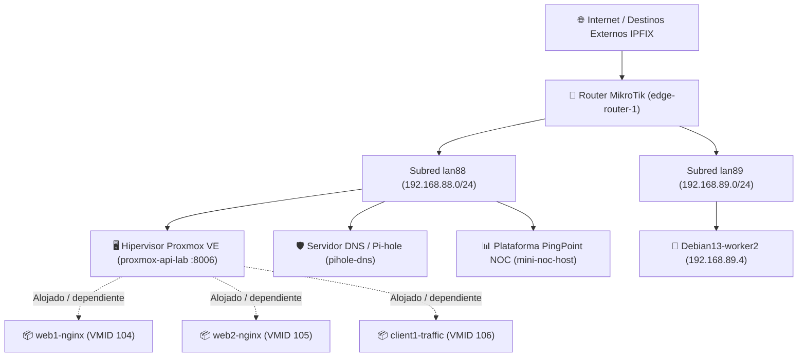

# Diseño Técnico: Mapa de Topología Dinámica y Árbol de Dependencias de Red (`Topology View`)

> **Estado:** Implementado (K86, K108); este documento conserva el diseño original.  
> **Fecha:** 10 de noviembre de 2026.  
> **Objetivo:** Visualización gráfica nativa (Cero CDN) de la infraestructura de red descubierta, correlación jerárquica de hipervisores y huéspedes, y árbol de supresión de alertas por dependencias.

---

## 1. Motivación y Objetivos

El PingPoint NOC monitoriza un entorno heterogéneo que incluye:
1. **Routers de borde** (MikroTik RouterOS `edge-router-1`) con múltiples interfaces y subredes (`lan88`, `lan89`, WAN).
2. **Servidores físicos o de plataforma** (`mini-noc-host`).
3. **Hipervisores Proxmox VE** (`proxmox-api-lab`, VM 103) que alojan múltiples invitados virtuales.
4. **Huéspedes virtualizados** (LXC y QEMU VMs: `web1-nginx`, `web2-nginx`, `client1-traffic`, `client2-traffic`, `pihole-dns`, `worker2`, etc.).
5. **Servicios de red críticos** (DNS RFC 1035 + Pi-hole API, syslog, agentes).

Hasta ahora, la relación entre estos componentes se consultaba de forma tabular dispersa (tabla de inventario en Settings/Health, tabla de Storage/Guests en Overview y selector de Target). 

El objetivo es incorporar la vista **`Topology`** (`/topology`), que proporciona:
* **Mapa de red visual e interactivo**: Representación clara de qué nodos cuelgan de cada subred o interfaz de router.
* **Agrupación física y virtual (Hypervisor Clusters)**: Visualización inmediata de qué máquinas virtuales y contenedores están anidados dentro de qué hipervisor Proxmox VE.
* **Árbol de dependencias en vivo (`depends_on`)**: Trazado visual de las rutas de dependencia y la propagación de fallos (explicando visualmente por qué las alertas de un hijo se encuentran en estado `SUPPRESSED` cuando su padre o router intermediario está caído).
* **Inspección rápida de telemetría**: Clic en cualquier nodo para desplegar una ficha flotante con su IP, latencia/pérdida ICMP, frescura del último dato, alertas activas y enlace directo al Target en Overview.

---

## 2. Requisitos No Negociables (del proyecto)

1. **Estricto CERO CDN y Cero Librerías Externas**:
   - Prohibido cargar librerías externas de grafos tipo D3.js, Vis.js, Cytoscape.js, Mermaid en tiempo de ejecución o frameworks pesados.
   - La visualización debe construirse íntegramente con **SVG nativo interactivo** generado dinámicamente con JavaScript modular (`web/static/js/views/topology.js`) o elementos CSS Flexbox/Grid con conectores SVG.
2. **Componentes Ligeros y Almacén SQLite**:
   - Todo se alimenta de las tablas ya existentes en SQLite (`devices`, `interfaces`, `proxmox_guests`, `alerts`, `maintenance_windows`).
   - Sin bases de datos orientadas a grafos ni dependencias adicionales en Python.
3. **Tiempos en UTC y Visualización en `Europe/Madrid`**:
   - Las fechas de actualización, último visto y ventanas de mantenimiento respetan la política global (K1).
4. **Fidelidad y Frescura del Dato**:
   - Cada nodo muestra visualmente la frescura de su telemetría.
   - Si no hay datos de un enlace o métrica, se explica explícitamente el motivo.
5. **Accesibilidad y Temas (Claro / Oscuro)**:
   - Colores y trazos configurados mediante las variables de diseño CSS existentes (`--bg-*`, `--text-*`, `--border-*`, `--accent-*`, `--green-*`, `--amber-*`, `--red-*`, tokens `--fs-*`).

---

## 3. Modelo de Datos y Contrato de API (`GET /api/topology`)

Se creará un endpoint unificado en FastAPI:
```http
GET /api/topology
```

### 3.1 Respuesta JSON del Endpoint
```json
{
  "ok": true,
  "generated_at_utc": 1794315200,
  "tz": "Europe/Madrid",
  "nodes": [
    {
      "id": "edge-router-1",
      "name": "MikroTik Router",
      "hostname": "router-main",
      "ip": "192.168.88.1",
      "device_type": "router",
      "status": "healthy",
      "parent_device_id": null,
      "depends_on": null,
      "subnet": "192.168.88.0/24",
      "reachable": 1,
      "last_seen_utc": 1794315190,
      "active_alerts_count": 0,
      "in_maintenance": false,
      "is_suppressed": false,
      "metrics": {
        "uptime_ticks": 178993800,
        "icmp_rtt_ms": 0.45,
        "icmp_loss_pct": 0.0
      }
    },
    {
      "id": "node-192-168-88-94",
      "name": "proxmox-api-lab",
      "hostname": "proxmox.lab",
      "ip": "192.168.88.94",
      "device_type": "proxmox",
      "status": "healthy",
      "parent_device_id": null,
      "depends_on": "edge-router-1",
      "subnet": "192.168.88.0/24",
      "reachable": 1,
      "last_seen_utc": 1794315180,
      "active_alerts_count": 0,
      "in_maintenance": false,
      "is_suppressed": false,
      "metrics": {
        "cpu_pct": 0.0,
        "mem_used_pct": 37.95,
        "rootfs_used_pct": 30.6
      }
    },
    {
      "id": "node-192-168-88-96",
      "name": "web1-nginx",
      "hostname": "web1-nginx",
      "ip": "192.168.88.96",
      "device_type": "linux",
      "status": "healthy",
      "parent_device_id": "node-192-168-88-94",
      "depends_on": "node-192-168-88-94",
      "subnet": "192.168.88.0/24",
      "reachable": 1,
      "last_seen_utc": 1794315175,
      "active_alerts_count": 0,
      "in_maintenance": false,
      "is_suppressed": false,
      "guest_info": {
        "vmid": 104,
        "guest_type": "lxc",
        "cpus": 1,
        "memory_bytes": 536870912
      }
    }
  ],
  "links": [
    {
      "source": "edge-router-1",
      "target": "subnet:lan88",
      "link_type": "interface",
      "label": "lan88 (192.168.88.1/24)"
    },
    {
      "source": "subnet:lan88",
      "target": "node-192-168-88-94",
      "link_type": "network",
      "label": "192.168.88.94"
    },
    {
      "source": "node-192-168-88-94",
      "target": "node-192-168-88-96",
      "link_type": "hypervisor_host",
      "label": "VMID 104 (LXC)"
    }
  ],
  "subnets": [
    {
      "id": "subnet:lan88",
      "name": "lan88",
      "cidr": "192.168.88.0/24",
      "interface_name": "lan88",
      "nodes_count": 8
    },
    {
      "id": "subnet:lan89",
      "name": "lan89",
      "cidr": "192.168.89.0/24",
      "interface_name": "lan89",
      "nodes_count": 2
    }
  ]
}
```

---

## 4. Diseño Visual y Motor de Renderizado

### 4.1 Enfoque SVG Nativo vs Canvas
Se elige **SVG vectorial dinámico** (`<svg id="topology-canvas">`) por las siguientes razones:
1. **Estilo CSS declarativo**: Los nodos y conectores heredan las variables de diseño de la aplicación (`var(--bg-card)`, `var(--border-subtle)`, `var(--green)`, `var(--red)`, etc.) con soporte automático para tema claro y oscuro.
2. **Interactividad DOM nativa**: Cada nodo es un elemento `<g class="topo-node">` que soporta eventos estándar de ratón (`mouseenter`, `mouseleave`, `click`, teclado con accesibilidad `tabindex="0"`).
3. **Escalabilidad infinita**: La imagen vectorial no pierde nitidez ante zoom de alta densidad (pantallas retina, 4K o monitores NOC).

### 4.2 Algoritmo de Disposición (Layout Jerárquico por Capas)
Para evitar algoritmos de fuerzas físicas pesados e impredecibles, se implementa un **Layout Jerárquico Determinista por Niveles (Ranked Layering)**:



* **Nivel 0 (Borde Exterior):** WAN / Destinos externos relevantes.
* **Nivel 1 (Puerta de enlace):** Router de borde (`edge-router-1`).
* **Nivel 2 (Subredes / Zonas):** Barras de bus de red agrupadoras (`lan88`, `lan89`).
* **Nivel 3 (Infraestructura Principal):** Hipervisores de virtualización, servidores DNS y nodos independientes.
* **Nivel 4 (Huéspedes Virtuales):** Agrupación en tarjeta envolvente (*Cluster Box*) de Proxmox con sus contenedores y máquinas virtuales.

---

## 5. Estados Visuales y Gestión de Dependencias

### 5.1 Codificación de Color por Salud
* 🟢 **Verde (`.topo-healthy`)**: Nodo alcanzable (`reachable = 1`), sin alertas activas y datos recientes.
* 🟡 **Ámbar (`.topo-warning`)**: Nodo alcanzable con alertas de severidad `warning` (p. ej. almacenamiento PVE >85% o pérdida ICMP moderada).
* 🔴 **Rojo (`.topo-critical`)**: Nodo inalcanzable (`reachable = 0`) o con alertas `critical`.
* 🔵 **Gris Azulado (`.topo-suppressed`)**: Nodo inalcanzable pero **suprimido** porque su hipervisor padre (`parent_device_id`) o su router intermedio (`depends_on`) está caído. Incluye distintivo `Suppressed by <parent>`.
* 🟠 **Amarillo Rayado (`.topo-maintenance`)**: Nodo dentro de una ventana de mantenimiento activa (`maintenance_windows`).

### 5.2 Conectores de Enlace (Links)
* **Línea continua gris**: Conexión de red activa regular.
* **Línea discontinua azul**: Relación de anidamiento de hipervisor / virtualización (`guest_of`).
* **Línea discontinua ámbar con animación suave**: Enlace de dependencia activa (`depends_on`). Al situar el cursor sobre un nodo, se iluminan únicamente sus ancestros y descendientes en la cadena de dependencias.

---

## 6. Interactividad y Ficha de Detalle

1. **Pan, zoom y tarjetas movibles** (eventos de puntero: ratón, lápiz y táctil; implementado el 11-11, K108/K110):
   - Un dedo o el botón izquierdo sobre el fondo arrastra el lienzo; dos dedos hacen zoom (pinch) alrededor de su punto medio.
   - Rueda del ratón (y pinch del trackpad) con zoom centrado en el cursor, entre 0,15× y 2,5×. Los botones `+` y `−` hacen zoom centrado en el panel.
   - **Arrastrar una tarjeta** la mueve junto con sus enlaces; la posición se guarda en el navegador (`localStorage`, clave `mininoc.topology.offsets`) y sobrevive a la recarga. El clic posterior a un arrastre no selecciona nada.
   - Botonera: `Fit View` ajusta el mapa al panel (también se hace solo al abrir la vista) y `Reset` olvida las tarjetas movidas y vuelve a la disposición automática.
   - Teclado: con el mapa enfocado, las flechas mueven el lienzo, `+`/`-` hacen zoom y `0` ajusta; con una tarjeta enfocada, `Intro` la selecciona y `Mayús`+flecha la mueve 20 unidades.
   - En pantallas estrechas el mapa se reparte en filas (dos tarjetas por fila en un móvil) para que quepa sin quedar diminuto; las filas impares se desplazan media tarjeta para que las líneas pasen por los huecos.
   - El estado de cada nodo va en un punto junto al tipo (no en una barra lateral); las subredes son estructura y nunca se atenúan con los filtros; si ninguna interfaz del router se llama como una subred, se enlaza a la subred de su propia dirección (o a todas, si es el único router).
2. **Barra de Herramientas y Filtros**:
   - **Buscador rápido**: Resalta nodos por nombre o IP al escribir.
   - **Filtro de tipo**: Mostrar/ocultar `Routers`, `Hipervisores`, `Huéspedes LXC/VM`, `DNS`, `Clientes`.
   - **Filtro de salud**: Botón «Show only issues» (oculta nodos sanos y muestra solo nodos con alertas, degradados o caídos).
3. **Ficha Lateral / Drawer de Nodo**:
   - Al hacer clic en un nodo, se abre un panel lateral con:
     - Nombre, Hostname, IP y Subred.
     - Tipo de equipo e insignia de estado.
     - Métricas en tiempo real (Latencia ICMP, Pérdida %, CPU/Memoria si están disponibles).
     - Relación de virtualización (Hipervisor padre, VMID, cores, RAM).
     - Dependencias configuradas (`depends_on`).
     - Alertas activas con acceso directo a silenciar o reconocer.
     - Botón `Open in Overview` que cambia de pestaña y selecciona el target automáticamente.

---

## 7. Plan de Implementación por Fases

| Fase | Tareas | Entregables | Verificación |
|---|---|---|---|
| **Fase 0** | Documento de diseño y arquitectura | `docs/diseno-topologia-red.md` | Aprobación del usuario |
| **Fase 1** | Endpoint backend `GET /api/topology` | `api/services.py`, `api/app.py` | Tests unitarios (`tests/test_topology_api.py`) con casos: router, Proxmox, huéspedes, dependencias y alertas |
| **Fase 2** | Estructura HTML y estilos CSS | `web/partials/tab_topology.html`, `web/static/css/topology.css` (o sección en `style.css`) | Cero CDN, uso de tokens `--fs-*` y temas claro/oscuro |
| **Fase 3** | Módulo JavaScript de renderizado | `web/static/js/views/topology.js` | Renderizado SVG determinista, zoom, pan, filtros y drawer lateral |
| **Fase 4** | Integración en Navegación y Bundle | `web/partials/header_nav.html`, `web/static/app.js`, `tools/build_bundle.py` | Pestaña `Topology`, atajo de teclado `T`, bundle regenerado |
| **Fase 5** | Batería de Tests y Regresión | Tests de API, de assets web y suite completa | 100% tests en verde |
| **Fase 6** | Despliegue y Verificación en Vivo | Despliegue en el contenedor de pruebas | Comprobación de renderizado con los 12 nodos reales |

---

## 8. Siguientes Pasos Inmediatos

Una vez aprobado este documento de diseño:
1. Procederemos con la **Fase 1**: desarrollo del servicio `get_network_topology` en `api/services.py` y endpoint `GET /api/topology` en `api/app.py`, acompañado de su suite de tests unitarios basada en muestras reales.

